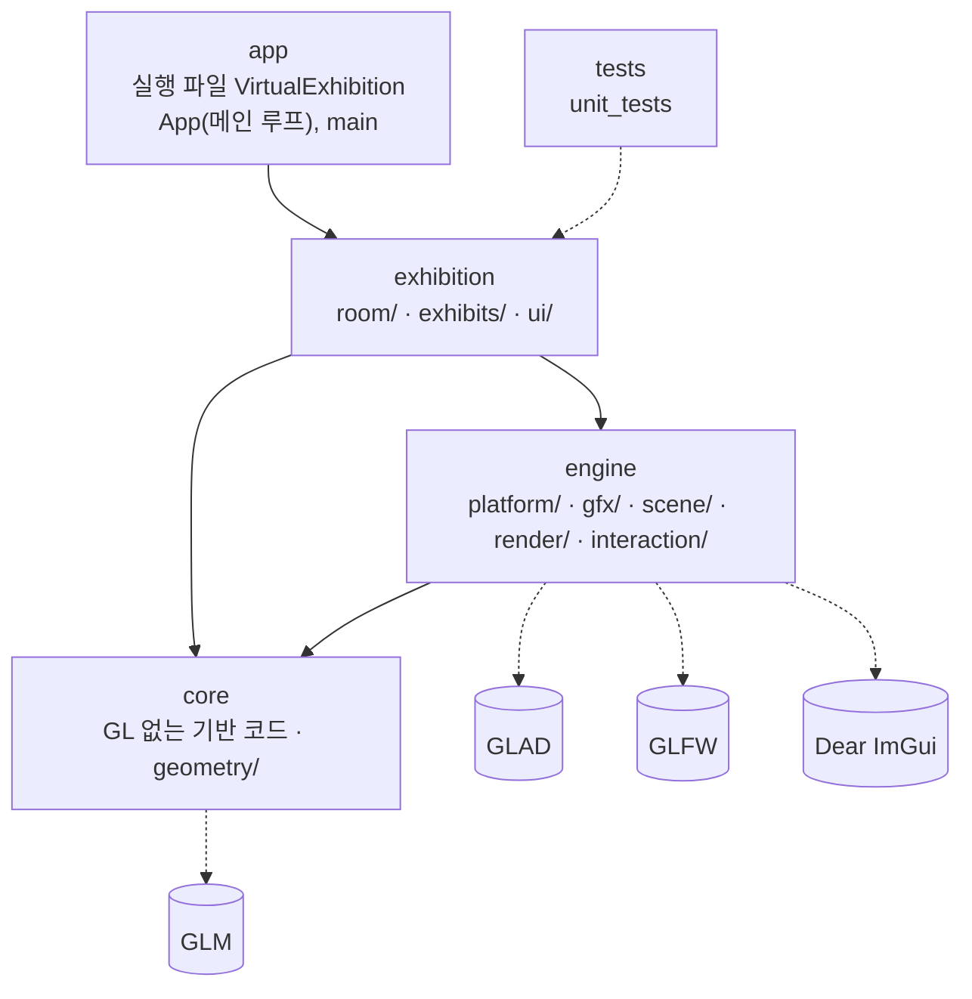

# Interactive 3D Virtual Exhibition

## 1. 사용 언어 · 라이브러리

| 항목 | 버전 |
|---|---|
| C++ | C++17 |
| 그래픽스 API | OpenGL 4.1 Core Profile, GLSL 410 |
| GLFW | 3.4 (FetchContent) |
| GLAD | glad 0.1.36 으로 생성한 OpenGL 4.1 Core 로더 (`external/glad/`) |
| GLM | 1.0.1 (FetchContent) |
| Dear ImGui | 1.91.8 (FetchContent) |
| CMake | 3.20 이상 (프리셋을 쓰려면 3.21 이상) |
| clang-format / clang-tidy | 23.1.3 |

허용된 라이브러리(GLFW, GLAD, GLM, Dear ImGui) 외에는 쓰지 않는다.

## 2. 환경 셋팅

| OS | 설치할 것 |
|---|---|
| Windows (MSVC) | Visual Studio 2022 이상 → **"C++를 사용한 데스크톱 개발"** 워크로드. 오른쪽 목록에서 **Windows 11 SDK** 와 **Windows용 C++ CMake 도구** 가 체크돼 있어야 한다. 일반 터미널에서도 `cmake` 를 쓰려면 `winget install Kitware.CMake` |
| Windows (MinGW) | MinGW-w64 GCC, Ninja, CMake 를 PATH 에 추가 (w64devkit 또는 MSYS2) |
| Linux (Ubuntu/Debian) | `sudo apt install build-essential cmake git libx11-dev libxrandr-dev libxinerama-dev libxcursor-dev libxi-dev libxext-dev libgl-dev` |
| macOS | `xcode-select --install`, `brew install cmake` |

처음 configure 할 때 라이브러리를 내려받으므로 인터넷이 필요하다.

> Windows 에서는 프로젝트를 짧은 경로(예: `C:\dev\...`)에 둔다. 내려받은 라이브러리가 깊은 폴더에 풀려
> 260자 경로 제한에 걸리면 configure 가 실패한다.

린트 도구(clang-format, clang-tidy 23.1.3)는 아래 스크립트 하나로 설치한다. 세 OS 공통이고 CMake 만 있으면 된다
(pip · 관리자 권한 · PATH 수정 불필요). `FinalProject/` 폴더에서 실행한다.

```bash
cmake -P scripts/install-lint-tools.cmake
```

- 받은 도구는 `.tools/llvm/bin/` 에 풀리고 CMake 가 자동으로 찾는다. git 에는 올라가지 않는다.
- 다시 설치하려면 `-DFORCE=ON` 을 앞에 붙이고, 지우려면 `.tools` 폴더를 지운다.

## 3. 빌드 · 테스트

`FinalProject/` 폴더에서 실행한다. `<preset>` 자리에 자기 환경의 프리셋 이름을 넣는다.

| 프리셋 | 환경 | 실행 파일 |
|---|---|---|
| `windows-msvc` | Visual Studio (MSVC) | `build\windows-msvc\bin\Debug\VirtualExhibition.exe` |
| `windows-mingw` | MinGW GCC + Ninja | `build\windows-mingw\bin\VirtualExhibition.exe` |
| `linux` | GCC + Makefiles | `./build/linux/bin/VirtualExhibition` |
| `macos` | Apple Clang + Makefiles | `./build/macos/bin/VirtualExhibition` |

```bash
cmake --preset <preset>
```

```bash
cmake --build --preset <preset>
```

```bash
ctest --preset <preset>
```

- 기본은 Debug 빌드다. Release 는 `cmake --preset <preset> -DCMAKE_BUILD_TYPE=Release`
  (`windows-msvc` 는 `cmake --build --preset windows-msvc --config Release`).
- 테스트는 `tests/` 에 `<이름>Test.cpp` 를 추가하면 자동으로 포함된다. 쓰는 법은 `tests/TestFramework.h` 맨 위 주석에 있다.
- 실행 중 조작: F1 은 ImGui 패널 보이기/숨기기, Esc 는 종료.

코드 검사:

| 하고 싶은 것 | 명령 |
|---|---|
| 코드 서식 자동 정리 | `cmake --build --preset <preset> --target format` |
| 정리 안 된 곳 검사 | `cmake --build --preset <preset> --target format-check` |
| 빌드하면서 clang-tidy 검사 | `cmake --preset <preset> -DVE_CLANG_TIDY=ON` 후 평소처럼 빌드 (Ninja/Makefile 프리셋만) |

## 4. 모듈 구조



| 모듈 (CMake 타깃) | 하는 일 | 하위 폴더 [담당] |
|---|---|---|
| `app` (`VirtualExhibition`) | 모든 모듈을 조립하는 메인 루프 | [코어] |
| `exhibition` (`ve_exhibition`) | 전시관 내용 | `room/` 방·전시대·조명 [A], `exhibits/` 전시물·데이터 로더 [B], `ui/` ImGui 패널 [B] |
| `engine` (`ve_engine`) | 화면에 그리고 조작하는 공통 기능 | `platform/` 창·입력·ImGui 초기화, `gfx/` OpenGL 래퍼, `scene/` Transform·Entity·Camera, `interaction/` 피킹·조립 규칙 [코어], `render/` 렌더러·PBR [코어]·그림자 [A] |
| `core` (`ve_core`) | GL·GLFW 없는 기반 코드 (수학, FrameTimer, 입력 상태) | `geometry/` MeshData·도형 생성 [B], 그 외 [코어] |

- 상위 모듈은 하위 모듈만 쓴다.
  - 반대 방향으로 의존하면 configure 가 실패한다 (`cmake/ProjectModules.cmake`).
  - `core` 에서 GL·GLFW 헤더를 include 하면 컴파일 에러가 난다.
- 모듈마다 `src/<모듈>/CMakeLists.txt` 가 있다. 하위 폴더는 정리와 담당 구분용이고, 그 안의 파일은 자동으로 빌드에 포함된다.
- include 는 모듈 이름부터 쓴다: `#include "engine/platform/Window.h"`
